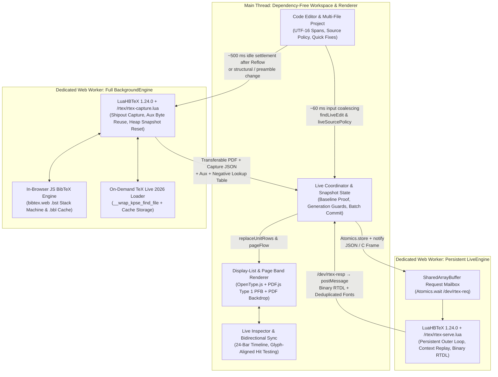

# ⚡ LightningTeX

**Genuine LuaHBLaTeX in the Browser — Millisecond Incremental Live Preview, Zero Backend.**

[**English**](README.md) · [**简体中文**](README.zh-CN.md) · [**Standalone Engine SDK**](engine/README.md) · [**Renderer Docs**](render/README.md) · [**Source Build Recipe**](engine/build/README.md) · [**Deployment**](docs/DEPLOYMENT.md) · [**QA & Benchmarks**](QA.md)

---

## Why LightningTeX?

Modern LaTeX tools have long forced writers into a compromise:

1. **Cloud or Traditional Full-Compile Editors** run real TeX, delivering authentic typography, macro expansion, and PDF output—but every edit waits seconds for a full-document compilation pass and server round-trip.
2. **Browser HTML / MathJax / KaTeX Previewers** respond in milliseconds—but they are **approximations**, not TeX. They rely on browser text layout rather than Knuth–Plass line breaking, substitute fonts, and cannot execute real LaTeX counters, preamble macros, or package hooks.

**LightningTeX eliminates this trade-off.** It brings [`realtime-tex`](https://github.com/HenryXiaoYang/realtime-tex)'s Lua-side incremental typesetting architecture directly into the browser via a custom-trimmed **LuaHBTeX 1.24.0 (TeX Live 2026) WebAssembly** runtime, paired with a dependency-free modern writing workspace.

### Core Product Philosophy

- **Real TeX, Never Approximated**: Every paragraph, inline or display formula (`equation`, `align`, `gather`, `multline`), list, heading, and theorem environment is typeset by **actual LuaHBLaTeX**. Glyphs are placed at integer **scaled-point (`sp`, $1\text{ pt} = 65536\text{ sp}$)** coordinates and drawn directly from engine font outlines (OpenType/TrueType glyph indices and original Type 1 PFB charstrings).
- **Two-Speed Hybrid Pipeline (Instant Local Reflow + Quiet Background Convergence)**:
  - **Fast Path (`Live` / `Reflow`, ~5–20 ms warm)**: A persistent LuaHBTeX worker stays alive inside TeX's outer loop (`\loop\rtexstep...\repeat`), replays the exact captured state of the edited unit, typesets only the affected unit in a `\vbox`, and updates the page canvas in place—stretching or slicing horizontal page bands when line counts or formula heights change (`pagination pending`).
  - **Slow Path (`Full`)**: After a provisional `Reflow`, ~500 ms of inactivity triggers background compilation to update pagination, page numbers, TOC/bookmarks, and bibliography. Preamble, cross-reference, or unsupported changes route directly to `Full`. Fixed-geometry `Live` updates keep the preview current without scheduling an idle full compile; PDF export compiles the latest source when needed.
- **Fail-Closed Correctness & Transparent Observability**: Before any unit is edited live, LightningTeX compiles its *original* captured source in the live worker and proves that every row box, glue setting, font descriptor, glyph index, and relative `sp` coordinate matches the full-compile baseline. Incomplete math delimiters or unbalanced braces never trigger noisy broken builds—the previous valid preview is calmly held while the caret math popover auto-repairs open groups. The top-bar **Live Inspector** shows the exact routing path, latency timeline, and PDF sync state for every keystroke.
- **100% Client-Side & Zero Backend**: All TeX compilation, BibTeX `.bst` interpretation, font outline parsing, and project persistence happen locally inside the browser. Your document content never leaves your machine.

---

## Quick Start

### 1. Run a Prebuilt Release Bundle

If you downloaded the ready-to-run release archive, no `npm install` or local TeX Live installation is required. Using **Node.js 22.12+**:

```sh
node server.mjs
```

Then open **http://127.0.0.1:4173** in a desktop browser (use `PORT=8080 node server.mjs` to customize the port).

> [!IMPORTANT]
> **Do not open `index.html` via `file://`**. Web Workers, streaming WASM assembly, and the `SharedArrayBuffer` incremental channel require a secure HTTP context (`http://127.0.0.1` or `https://`) with Cross-Origin Isolation headers (`COOP: same-origin`, `COEP: require-corp`). `server.mjs` configures these headers automatically on `127.0.0.1`. For production static hosting, see [docs/DEPLOYMENT.md](docs/DEPLOYMENT.md).

### 2. Run from Source

```sh
npm ci
npm run dev       # Start Vite dev server
npm run build     # Build production web app into dist/
npm run preview   # Serve dist/ on http://127.0.0.1:4173 with COOP/COEP headers
```

On first launch, LightningTeX streams **~42.4 MiB** of gzip-compressed engine and TeX Live basic assets (~54.4 MiB unpacked; internal TeX files remain stored in 16 KiB LZ4 blocks) with staged progress so you can start editing immediately. Additional packages (`microtype`, `booktabs`, `enumitem`, etc.) are fetched on demand when used in a document and persisted in browser `Cache Storage`.

---

## Technical Architecture



### 1. Dual-Worker LuaHBTeX Runtime & Zero-Asyncify IPC

A browser WASM port of incremental TeX faces a fundamental runtime constraint: **a Web Worker synchronously blocked inside a C/Lua read loop cannot process `postMessage` callbacks**, while spawning a fresh TeX process per edit destroys millisecond latency.

- **`SharedArrayBuffer` Device Bridge**: Rather than compiling LuaTeX with Emscripten Asyncify, [`public/runtime/live-worker.js`](public/runtime/live-worker.js) registers two virtual character devices: `/dev/rtex-req` reads requests from a 1 MiB `SharedArrayBuffer`, while `/dev/rtex-resp` returns frames through transferable `postMessage` buffers. Inside LuaHBTeX, [`rtex-serve.lua`](engine/tex/rtex-serve.lua) executes `\loop\rtexstep\ifnum\rtexcontinue>0 \repeat`. When waiting for the next edit, the synchronous POSIX `read()` blocks inside `Atomics.wait` with the entire TeX state, preamble macros, and loaded fonts kept warm in memory.
- **Shared `WebAssembly.Module`, Isolated Heap**: `BackgroundEngine` compiles `luahbtex.wasm` once and passes the compiled `WebAssembly.Module` to `LiveEngine`, avoiding another WASM download, decompression, and compilation. Each worker loads its own TeX data image and keeps its linear memory and virtual filesystem isolated.
- **State Hygiene & Watchdog Recovery**: After typesetting each unit inside an isolated `\vbox`, `rtex-serve.lua` verifies and restores TeX registers, counters, and macro fingerprints. State leaks, internal faults, or a 6-second live timeout discard the worker. Document edits fall back to `Full`, which prepares the next live instance; the math popover quarantines crashing formulas and warms a replacement directly.

### 2. Document Capture, Context Replay & Baseline Proof

- **Full-Pass Instrumentation (`rtex-capture.lua`)**: During full compilation, LuaTeX hooks record every document unit (`par`, `equation`, `align`, `gather`, `multline`, `displaymath`, `theorem`/`lemma`/`proposition`/`corollary`/`remark`, `proof`, `abstract`, `itemize`/`enumerate`/`description`, `quote`/`quotation`, and `\section`…`\subparagraph`), exporting delta-encoded counters, `\the<counter>` formats, NFSS font descriptors, paragraph parameters (`\parindent`, `\leftskip`, `\rightskip`, `\parfillskip`, `parshape`, `everypar`), and per-page display lists.
- **Cumulative Context Reconstruction ([`core/capture.js`](core/capture.js))**: To typeset unit $k$ in isolation, `unitContext(capture, unit)` replays all document-order deltas from unit $1 \dots k$, reconstructing the exact counter values, NFSS font state, color stack, and paragraph geometry active at the start of unit $k$.
- **Mandatory Baseline Proof (`compareUnitBaseline`)**: Before accepting the *first* live edit on any captured unit, the host compiles the unit's *original* captured source in `LiveEngine` and verifies that the resulting display list matches the full-pass capture row-for-row: box dimensions (`w`, `h`, `d`), glue settings (`gs`, `gsign`, `gorder`), font keys, glyph indices, and relative `sp` coordinates.
- **Multi-File Span Tracking & Atomic Batching ([`core/document.js`](core/document.js))**: Tracks UTF-16 source spans across the root `.tex` file, `\input` (including nested files and final paragraphs closed after TeX returns to the parent file), and `\include` files. Rapid edits across multiple files are validated and rendered as an atomic batch—any failure or stale revision cleanly aborts without partial UI updates.

### 3. Exact Glyph-Index Rendering, Type 1 PFB Pipeline & Provisional Reflow

- **Direct Outline Renderer ([`render/canvas-renderer.mjs`](render/canvas-renderer.mjs))**: Decodes binary `RTDL` v1 display lists and paints quadratic/cubic Bézier curves directly from font outlines in font units (`CSS_PX_PER_SP = 96 / (72.27 * 65536)`), applying horizontal font expansion (`microtype`), extend, and slant transforms (`y`-up to `y`-down) identical to upstream `rtex-verify`. Browser `fillText`, Unicode glyph substitution, and OS text shaping are never used.
- **Type 1 PFB Conversion with No Additional Dependency ([`render/type1-font.mjs`](render/type1-font.mjs))**: Classic Computer Modern / Latin Modern math extensions and T1 text fonts use PostScript Type 1 `.pfb` outlines and 256-entry encoding vectors. LightningTeX synthesizes a tiny in-memory 1-page PDF using all 256 character codes, passes it once through the already-loaded `PDF.js` worker to extract converted OpenType outlines and exact `originalCharCode -> glyphIndex` mappings, and caches the parsed font—supporting math glyphs even if they never appeared in the initial PDF.
- **Guarded Ink Patching vs. Provisional Band Reflow ([`core/live-layout.js`](core/live-layout.js))**:
  - **Fixed Geometry (`Live`)**: Computes conservative control-point `inkBounds`, verifies zero intersection with neighboring lines, images, or page headers/footers (`unitInkRegion`), clears only the guarded box over the cached PDF.js page raster, and draws the updated TeX rows.
  - **Variable Geometry (`Reflow`)**: When line counts or formula heights change—or when paragraphs are split, deleted, or merged—`pageFlow` slices the cached PDF page canvas into horizontal bands, expanding or contracting the edited band and shifting lower PDF slices vertically while marking the preview as `pagination pending`. After ~500 ms of idle time, the background worker restores exact global pagination.
  - **Hue-Preserving Dark Pages ([`render/dark-page.mjs`](render/dark-page.mjs))**: In dark mode, low-saturation pixels are inverted by luminance onto `#1c1e22` dark paper while colored figures preserve their original hues—applied consistently across full PDF renders and live repainted bands.

### 4. Source-Trimmed WASM, Single-Pass Aux Reuse & JS BibTeX

- **44.2% Smaller Compressed Startup Assets ([`engine/build/`](engine/build/README.md))**: Compiled directly from TeX Live 2026 source (`LuaHBTeX 1.24.0`) with Emscripten 5.0.4 (`-Oz`), linking only LuaHBTeX, HarfBuzz/Graphite, Kpathsea, and PDF/font libraries while stripping pdfTeX, XeTeX, BibTeX, MakeIndex, DVI applets, ICU, and fontconfig. The `/rtex` Lua/TeX service is embedded directly into the WASM image, and the TeX Live data package is pruned by 1,587 files and packed with paired 16 KiB LZ4 chunks:
  - **Raw WASM binary**: `31.0 MiB` → **`4.68 MiB`** (`1.83 MiB` gzip)
  - **Total compressed startup transfer**: `76.0 MiB` → **`42.4 MiB`** (`54.4 MiB` unpacked)
- **Single-Pass Auxiliary Reuse & Cold First-Pass Fast Hook ([`public/runtime/background-worker.js`](public/runtime/background-worker.js))**:
  - Full compilations retain `.aux` (including nested `\include` aux files), `.toc`, `.out`, `.lof`, `.lot`, and `.bbl` for the active root and preamble. When these outputs remain unchanged after pass 1, no rerun warning is emitted, and no unrecognized auxiliary output exists, the second pass is skipped—cutting warm full-compile times roughly in half (~1.4 s → ~0.6–0.7 s).
  - On cold first compiles where a second pass is mandatory, pass 1 dynamically unhooks `rtex-capture`'s shipout page traversal and JSON export (`\RemoveFromHook` / `remove_from_callback`), saving ~110–210 ms in the recorded benchmarks while preserving normal TeX pagination and package hooks.
- **In-Browser `.bst` BibTeX Interpreter ([`public/runtime/bibtex.js`](public/runtime/bibtex.js))**: Implements a full `.bst` stack machine in pure JavaScript following `bibtex.web` (supporting `format.name$`, `change.case$`, `text.prefix$`, `purify$`, `width$`, cross-references, sorting, and 79-column wrapping). Generates `.bbl` between passes (including `biblatex` with `backend=bibtex`), fetches missing `.bst` styles from the TeX Live service, and maps BibTeX warnings directly to `.bib` entry line numbers.
- **On-Demand TeX Live 2026 Package Service & Negative Lookup Sharing**: Missing packages and fonts are fetched via `__wrap_kpse_find_file`. Full jobs persist their downloads in browser `Cache Storage` for both workers to restore; live-only downloads stay in memory. Bundled font companion misses (`.ofm`, `.ovf`, `.vf`) and 404 results from full compiles are shared with the live worker in-session to avoid repeating those network probes.

---

## Writing Workspace Highlights

LightningTeX's UI ([`ui/`](ui/editor.js)) is built from scratch with zero frontend framework dependencies, designed around typographic clarity, keyboard speed, and immediate visual feedback:

| Category | Capabilities |
| :--- | :--- |
| **Live Inspector & Status Capsule** | Top-bar status capsule displays real-time update latency (`Live 6.1 ms`) and a 12-bar sparkline. Clicking opens the **Live Inspector**: a 24-bar timeline (`Live`, `Reflow`, `Full`, `Waiting`), localized routing explanation, live worker status & restart count, median latency, and PDF sync state (in sync, behind by a number of edits, or updating). |
| **Bidirectional Source ⇄ Preview Sync** | **Source → Preview**: Moving the caret highlights the corresponding paragraph/formula/heading on the page margin and shows an edge chip when scrolled out of view.<br>**Preview → Source**: Clicking a rendered line uses `alignGlyph` to match NFKC-normalized glyph codepoints, ligatures, and math italics to source text. It jumps to the matched word, or an approximate row position when no match is found. |
| **Caret Math Popover & Hover Cards** | **Math Popover**: Live-typesets the formula under the caret using the document's preamble macros and fonts, automatically closing unfinished braces/delimiters/environments.<br>**Hover Cards** (400 ms dwell): Preview typeset target equations on `\ref`/`\eqref`, image thumbnails & dimensions on `\includegraphics`, macro definitions, and `.bib` entry titles, authors, years, and metadata. `Ctrl/Cmd + Click` or `F12` jumps to definition. |
| **LaTeX Intelligence & Quick Fixes** | **Cross-File Rename (`F2`)**: Rename any `\label` or reference across all project files in one atomic step with live impact preview and multi-file undo; `Shift + F12` opens the References panel.<br>**Quick Fixes (`Ctrl/Cmd + .` or gutter 💡)**: Suggests packages for unknown commands/environments using mappings to 80+ packages, fixes command typos via edit distance, adds `\newtheorem`, wraps bare math in `$…$`, resolves nearest label/citation/file names, and locates unclosed braces. |
| **Completion, Snippets & Builders** | Context-aware completion for commands, environments, labels, file paths, and `.bib` citations (by key, author, year, or title). Tab-stop snippets (`fig`, `tab`, `mat`, `eq`, `beg`) with mirrored placeholders. Visual **Table & Matrix Builder** (up to 10×8 grid, `booktabs` three-line tables, 6 matrix bracket styles, Tab cell navigation, auto package insertion). |
| **PDF Text Layer, Spreads & Zoom** | Full-compiled pages include an interactive **PDF.js Text Layer** (drag to select/copy text, while single-click still jumps to source) and in-PDF search (`Ctrl/Cmd + F` inside preview). Supports pinch/wheel pointer-anchored zoom, single-page / two-page / cover spreads, page thumbnail rail (`Ctrl/Cmd + Alt + T`), and hue-preserving **Dark Pages**. |
| **Multi-Project & Local History** | **IndexedDB v3 Multi-Project Store** (`Ctrl/Cmd + O`) with first-page thumbnails, per-tab project isolation, template gallery, drag-and-drop image conversion (GIF/WebP/BMP → PNG in `figures/`), and ZIP import/export.<br>**Local History**: Saves up to 30 text-file snapshots per project (at 5-minute intervals after successful full compiles) with an integrated Myers line-diff viewer. Restore all project text or a single file while keeping current images and other binary assets. |

### Essential Keyboard Shortcuts

| Shortcut (macOS / Win & Linux) | Action |
| :--- | :--- |
| `⌘Enter` / `Ctrl+Enter` | Run full LuaHBLaTeX compilation |
| `⌘K` / `Ctrl+K` | Open Command Palette (`@` sections/labels, `>` commands, `:line` jump) |
| `⌘.` / `Ctrl+.` | Open Quick Fix menu on diagnostic line |
| `F2` / `F12` / `⇧F12` | Rename label across files / Go to definition / Find all references |
| `⌘F` / `Ctrl+F`; `⌘⇧H` / `Ctrl+Shift+H` | Find / Replace in source (or Search in PDF when preview is focused) |
| `⌘\` / `Ctrl+\` | Cycle layout (`Source` / `Split` / `Preview`) |
| `⌘B` / `⌘J` / `⌥⌘T` | Toggle Sidebar / Problems & Log Panel / PDF Page Thumbnails |
| `⌘O` / `⌘,` | Open Projects Dashboard / Settings Dialog |
| `⌥↑` `⌥↓` / `⇧⌥↓` / `⌘⇧K` | Move line up or down / Duplicate line / Delete line |
| `⌘L` / `⌘D` | Select line (repeat to expand) / Select word and next occurrence |

---

## Standalone WASM Engine SDK (`@lightningtex/engine`)

The complete LuaHBTeX incremental runtime is cleanly decoupled from the editor UI and can be built and deployed as a standalone, zero-dependency browser ES module:

```sh
npm run build:engine   # Generates relocatable dist-engine/
npm run test:engine    # Copies dist-engine/ outside the repo and runs real WASM verification
```

```js
import {
  createEngine, splitPreamble, captureSpans, unitContext,
  liveUnitEligibility, compareUnitBaseline, decodeDisplayList,
} from './dist-engine/index.js';

const engine = await createEngine({
  onLog: console.log,
  onFonts: fonts => { /* Receive each font Uint8Array once per live worker */ },
});

// 1. Full compilation with capture instrumentation & auxiliary reuse
const full = await engine.background.compile(source, { root: 'main.tex', files: [] });

// 2. Start persistent live worker (reuses compiled WebAssembly.Module)
await engine.live.start(
  splitPreamble(source).preamble + '\n\\RequirePackage{luatexbase}\n',
  full.aux, [], full.packageMisses,
);

// 3. Prove baseline equivalence on first edit, then typeset incrementally
const span = captureSpans(source, full.capture).find(s => liveUnitEligibility(full.capture, s.unit).ok);
const ctx = unitContext(full.capture, span.unit);
const baseline = decodeDisplayList((await engine.live.compile(ctx, span.original, span.unit.advanced)).binary);
if (!compareUnitBaseline(span.unit, full.pages, baseline).ok) throw new Error('Baseline mismatch');

const liveResult = await engine.live.typeset(ctx, 'Updated paragraph with $\\sum_{i=1}^n x_i$.');
const displayList = decodeDisplayList(liveResult.binary);
```

See [**engine/README.md**](engine/README.md) for the complete API reference and [**render/README.md**](render/README.md) for the standalone Canvas display-list renderer.

---

## Verification & Benchmarks

LightningTeX is verified by **208 unit/DOM/renderer tests** and a suite of **real-WASM integration and differential benchmarks** (running the actual Emscripten LuaHBTeX binary, Lua scripts, and Worker code in both Node `worker_threads` and desktop Chromium):

| Benchmark / Verification Suite | Command | Key Verified Result |
| :--- | :--- | :--- |
| **Source-Trimmed Engine & Startup** | `node tests/engine-benchmark.mjs /tmp/engine-benchmark.json` | Cold engine load median **342 ms** (down from 689 ms); live service startup **675 ms** (down from 993 ms); warm core IPC + WASM request **0.23–0.27 ms**; 100% identical glyph/rule/coordinate signatures across 3 rounds. |
| **26-Edit Math & Prose Regression** | `npm run test:incremental` | **1 initial full compile, 0 live worker restarts** across 26 sequential inline/display/align/T1/Type 1 math edits; final glyph identities and `sp` coordinates match an independent fresh full compile 100%. |
| **18-Scenario Provisional Reflow** | `npm run test:reflow` | Verifies paragraph split/merge/delete, taller formulas, lists, headings, and theorem families (`theorem`/`lemma`/`proposition`/`corollary`/`remark`) with shared numbering against independent full compiles. |
| **112-Step Cumulative Edit Sequence** | `npm run test:sequence` | 112 accepted live edits + 17 incomplete math inputs across page boundaries with **1 initial full compile, 0 restarts**, verified at 15 full-ink checkpoints (Node compile+render median **5.95 ms**). |
| **13-Page Academic Paper (Browser)** | `tests/browser-input.html` | Real 13-page paper (46.5 KB source + 2 PDF figures): 20-key theorem typing (`9.9–17 ms` Live) and 61-key cross-page proof typing (`16–39 ms` Live) with **0 full compiles while typing** and automatic idle settlement after 530 ms. |
| **Multi-File Live Coalescing** | `npm run test:live-project` | Exercises real `main.js` + WASM + Canvas across `\input`, `\include`, nested child EOF paragraphs, batched multi-file edits, stale-response rejection, and atomic fallback. |
| **Full-Compile Aux Reuse & Cold Pass** | `npm run test:preview` | Single-pass auxiliary reuse cuts warm full compiles on TOC/bookmark/include documents from **~1.25–1.43 s to ~0.62–0.71 s**; cold first-pass capture skip saves **~110–210 ms** with byte-identical normalized PDF output. |

### Compilation Routing & Runtime Model

- **Incremental vs. Full-Document Routing**: Edits within captured prose, math environments, theorems, lists, quotes, and section headings execute on the persistent `LiveEngine` (`Live` when row geometry is unchanged; `Reflow` when line counts or heights change). Edits to the preamble, macro definitions, document class/packages, raw PDF literals/TikZ graphics, or cross-file structural layout automatically trigger a background `Full` compilation pass.
- **Idle Pagination Convergence & Export**: Provisional `Reflow` schedules a background full compilation after ~500 ms of inactivity; fixed-geometry `Live` updates do not schedule this pass. Export compiles the current source if the PDF is behind. Compilation runs at most two passes, or three after a bibliography update; if the log still requests a rerun, compile again to finish resolving references.
- **Bibliography Pipeline**: The background worker includes a JavaScript BibTeX engine supporting standard `.bst` styles (including `biblatex` with `backend=bibtex`), running up to 3 passes when `.bbl` output changes and reusing cached `.bbl` files on subsequent edits.
- **Sandboxed Client Execution**: All compilation runs inside the browser's WebAssembly virtual filesystem with `--no-shell-escape` and `--nosocket`. When a document references an unbundled TeX Live package or font, the runtime fetches that file by name from `https://texlive2026.texlyre.org` (configurable or disableable via `endpoint: ''`). Background jobs persist downloaded files in browser `Cache Storage`.

Detailed benchmark traces and test artifacts are available in [**QA.md**](QA.md) and [`qa/`](qa/).

---

## Repository Structure

```text
LightningTeX/
├── main.js                  # Application coordinator: PDF.js rendering, live patching/reflow, glyph hit-testing
├── server.mjs               # Zero-dependency local HTTP server with COOP/COEP isolation headers
├── core/                    # Pure domain logic: source policy, span mapping, context replay, live layout, diff, quick-fix
├── engine/                  # Standalone @lightningtex/engine entry, worker clients, embedded Lua/TeX (/rtex), WASM build recipe
├── render/                  # RTDL binary display-list decoder, OpenType/Type 1 PFB canvas renderer, dark-page filter
├── ui/                      # Dependency-free workspace UI: code editor, inspector, hovercards, completion, IndexedDB v3 store
├── public/
│   ├── luahbtex/            # Source-built LuaHBTeX 1.24.0 WASM & pruned TeX Live 2026 LZ4/gzip chunks
│   └── runtime/             # Web Workers (background-worker, live-worker, raw-loader, tex-packages, JS bibtex)
├── scripts/                 # Asset verification, 16 MiB chunk packager, and standalone engine builder
├── tests/                   # 208 unit/DOM tests + real-WASM incremental, reflow, sequence, bibliography & benchmark suites
└── docs/                    # Self-hosting deployment guide, port audit, and runtime probe documentation
```

### Development Commands

```sh
npm test                     # Run all 208 unit, DOM, and display-list renderer tests
npm run test:runtime         # Smoke-test WASM full compile, capture, and error recovery
npm run test:integration     # End-to-end WASM integration test
npm run test:preview         # Verify full-compile auxiliary reuse, cold-pass optimization, and PDF/TOC output
npm run test:incremental     # 26-edit real-WASM incremental math & prose exact-coordinate regression
npm run test:reflow          # 18-scenario real-WASM provisional reflow & theorem family verification
npm run test:sequence        # 112-edit cumulative live typing & incomplete-math resilience benchmark
npm run test:project         # Multi-file project & formula preview WASM regression
npm run test:live-project    # Full main.js + WASM + Canvas multi-file live batching test
npm run test:bibliography    # In-browser JS BibTeX (.bst) + WASM multi-pass bibliography regression
npm run test:engine          # Build and verify relocated standalone @lightningtex/engine package
```

---

## Provenance & License

LightningTeX builds upon the following open-source projects:

- **[realtime-tex](https://github.com/HenryXiaoYang/realtime-tex)** (MIT, pinned commit `1f681835cfcbeeabcca340b7784316a0ef186d81`) — Lua incremental capture, context replay, persistent service, and binary display-list protocol.
- **[TeXlyre BusyTeX](https://github.com/TeXlyre/texlyre-busytex/releases/tag/assets-v1.4.0) & [texlyre-busytex-build](https://github.com/TeXlyre/texlyre-busytex-build)** (`f544a51a`, TeX Live 2026 / LuaHBTeX 1.24.0) — Web2C Emscripten build rules and baseline TeX Live 2026 data snapshot.
- **[PDF.js](https://github.com/mozilla/pdf.js)** (`6.4.299`, Apache-2.0) — Full PDF page rasterization, text layer, and Type 1 PFB charstring conversion.
- **[OpenType.js](https://github.com/opentypejs/opentype.js)** (`2.0.0`, MIT) — Glyph outline parsing for the display-list Canvas renderer.
- **[Inter](https://github.com/rsms/inter)** (`5.2.5`, SIL OFL 1.1) — Bundled Latin variable UI font.

This project is distributed under the **GNU Affero General Public License v3.0 or later ([AGPL-3.0-or-later](LICENSE))**. Bundled TeX engines, macro packages, and fonts retain their individual licenses; see [**THIRD-PARTY-NOTICES.md**](THIRD-PARTY-NOTICES.md) for complete provenance and hashes. PDF documents and source files created by users with LightningTeX are not subject to the AGPL.
