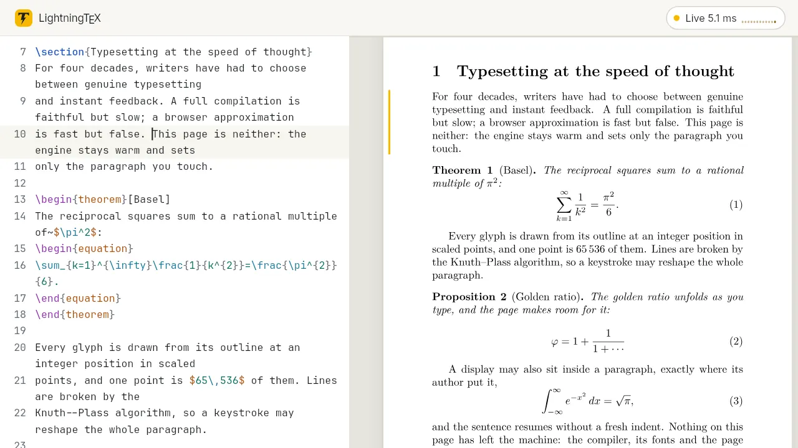
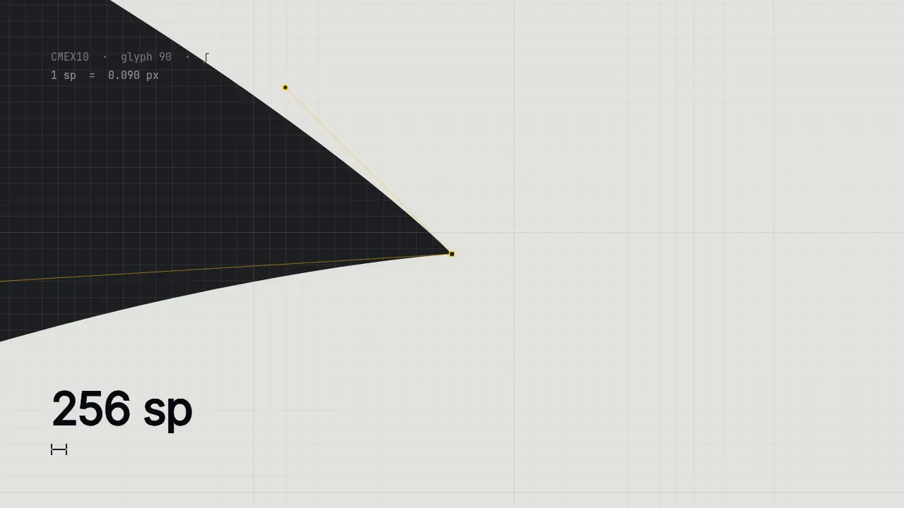
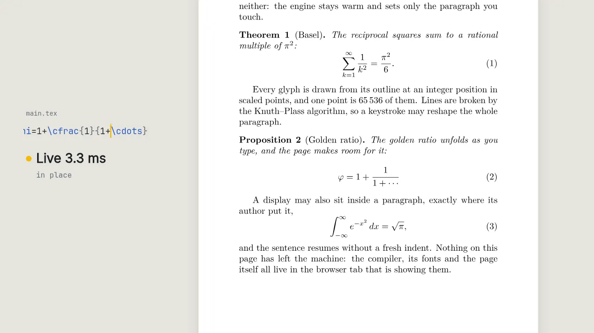
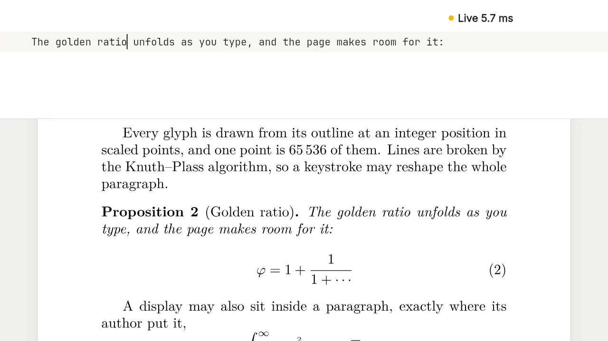
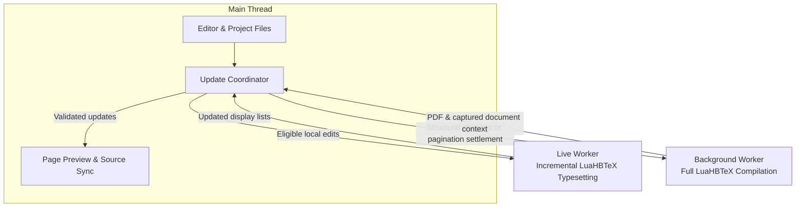

# ⚡ LightningTeX

**Genuine LuaHBLaTeX in the Browser — Millisecond Incremental Live Preview, Zero Backend.**

[**English**](README.md) · [**简体中文**](README.zh-CN.md) · [**Standalone Engine SDK**](engine/README.md) · [**Renderer Docs**](render/README.md) · [**Source Build Recipe**](engine/build/README.md) · [**Deployment**](docs/DEPLOYMENT.md) · [**QA & Benchmarks**](QA.md)

<p align="center">
  
</p>

---

## Why LightningTeX?

Modern LaTeX tools have long forced writers into a compromise:

1. **Cloud or Traditional Full-Compile Editors** run real TeX, delivering authentic typography, macro expansion, and PDF output—but every edit waits seconds for a full-document compilation pass and server round-trip.
2. **Browser HTML / MathJax / KaTeX Previewers** respond in milliseconds—but they are **approximations**, not TeX. They rely on browser text layout rather than Knuth–Plass line breaking, substitute fonts, and cannot execute real LaTeX counters, preamble macros, or package hooks.

**LightningTeX eliminates this trade-off.** It brings [`realtime-tex`](https://github.com/HenryXiaoYang/realtime-tex)'s Lua-side incremental typesetting architecture directly into the browser via a custom-trimmed **LuaHBTeX 1.24.0 (TeX Live 2026) WebAssembly** runtime, paired with a dependency-free modern writing workspace.

### Core Product Philosophy

- **Real TeX, Never Approximated**: Every paragraph, inline or display formula (`equation`, `align`, `gather`, `multline`), list, heading, and theorem environment is typeset by **actual LuaHBLaTeX**. Glyphs are placed at integer **scaled-point (`sp`, $1\text{ pt} = 65536\text{ sp}$)** coordinates and drawn directly from engine font outlines (OpenType/TrueType glyph indices and original Type 1 PFB charstrings).
- **Two-Speed Hybrid Pipeline (Instant Local Reflow + Quiet Background Convergence)**:
  - **Fast Path (`Live` / `Reflow`, ~5–20 ms warm)**: A persistent LuaHBTeX worker stays alive inside TeX's outer loop (`\loop\rtexstep...\repeat`), replays the exact captured state of the edited unit, typesets only the affected unit in a `\vbox`, and updates the page canvas in place—stretching or slicing horizontal page bands when line counts or formula heights change (`pagination pending`).
  - **Slow Path (`Full`)**: After a provisional `Reflow`, ~500 ms of inactivity triggers background compilation to update pagination, page numbers, TOC/bookmarks, and bibliography. Preamble, cross-reference, or unsupported changes route directly to `Full`. Fixed-geometry `Live` updates keep the preview current without scheduling an idle full compile; PDF export compiles the latest source when needed.
- **Fail-Closed Correctness & Transparent Observability**: Before any unit is edited live, LightningTeX compiles its *original* captured source in the live worker and proves that every row box, glue setting, font descriptor, glyph index, and relative `sp` coordinate matches the full-compile baseline. Incomplete math delimiters or unbalanced braces never trigger noisy broken builds—the previous valid preview is calmly held while the caret math popover auto-repairs open groups. The top-bar **Live Inspector** shows the exact routing path, latency timeline, and PDF sync state for every keystroke.
- **100% Client-Side & Zero Backend**: All TeX compilation, BibTeX `.bst` interpretation, font outline parsing, and project persistence happen locally inside the browser. Your document content never leaves your machine.

<table>
<tr>
<td width="33%" valign="top"><br><sub><b>Integer scaled points.</b> Glyphs are drawn from their own Bézier outlines at integer <code>sp</code> positions.</sub></td>
<td width="33%" valign="top"><br><sub><b>Band reflow.</b> A taller formula opens its band and slides the page below it, while exact pagination settles in the background.</sub></td>
<td width="33%" valign="top"><br><sub><b>Never a broken frame.</b> An unclosed <code>\(</code> holds the page while the caret popover sets the repaired formula.</sub></td>
</tr>
</table>

<sub>Every animation here is rendered frame by frame from recorded engine output (display lists, glyph outlines and measured latencies). Nothing is mocked up.</sub>

---

## Quick Start

### 1. Run a Prebuilt Release Bundle

If you downloaded the ready-to-run release archive, no `npm install` or local TeX Live installation is required. Using **Node.js 22.12+**:

```sh
node server.mjs
```

Then open **http://127.0.0.1:4173** in a desktop browser (use `PORT=8080 node server.mjs` to customize the port).

> [!IMPORTANT]
> **Do not open `index.html` via `file://`**. Web Workers, streaming WASM assembly, and the `SharedArrayBuffer` incremental channel require a secure HTTP context (`http://127.0.0.1` or `https://`) with Cross-Origin Isolation headers (`COOP: same-origin`, `COEP: require-corp`). `server.mjs` configures these headers automatically on `127.0.0.1`. For production static hosting, see [docs/DEPLOYMENT.md](docs/DEPLOYMENT.md).

### 2. Run from Source

```sh
npm ci
npm run dev       # Start Vite dev server
npm run build     # Build production web app into dist/
npm run preview   # Serve dist/ on http://127.0.0.1:4173 with COOP/COEP headers
```

To publish on Vercel, install its CLI, run `vercel login`, then `vercel --prod` from the repository root. The included configuration supplies the required routes and headers; see the [Vercel deployment steps](docs/DEPLOYMENT.md#deploy-to-vercel).

On first launch, LightningTeX streams **~42.4 MiB** of gzip-compressed engine and TeX Live basic assets (~54.4 MiB unpacked; internal TeX files remain stored in 16 KiB LZ4 blocks) with staged progress so you can start editing immediately. Additional packages (`microtype`, `booktabs`, `enumitem`, etc.) are fetched on demand when used in a document and persisted in browser `Cache Storage`.

---

## Technical Architecture

LightningTeX separates the writing workspace from two browser-based LuaHBTeX workers: one keeps local edits responsive, while the other produces the complete PDF and document layout.



### Two Complementary Compilation Paths

The live worker keeps the TeX runtime, preamble, and fonts loaded between edits. A shared-memory request channel lets it receive work while TeX remains inside its synchronous processing loop. The background worker handles full-document compilation, including cross-references and bibliography. Both workers reuse the compiled WebAssembly module but keep their memory and filesystems isolated.

### Capture, Replay & Verification

Full compilation captures the layout and typesetting context of each supported document unit. Local edits replay that context to preserve counters, fonts, and paragraph geometry. Before a unit's first live edit, its original source is re-typeset and checked against the full-compile baseline. Unsupported edits or failed checks fall back to full compilation; multi-file updates are applied together only when the whole batch is valid and current.

### Preview from TeX Output

The renderer draws glyph outlines at the positions supplied by TeX, combining local updates with PDF.js page rendering rather than using browser text layout. Fixed-geometry edits repaint only the affected region (`Live`). Changes in height resize page bands and shift the content below (`Reflow`), with exact pagination restored by a background compile after typing pauses. Incomplete input keeps the last valid preview visible.

### Reuse Across Compilations

A trimmed WebAssembly build and on-demand TeX packages keep the initial runtime focused. Browser caching reduces repeated resource downloads, while auxiliary-file reuse avoids unnecessary compilation passes. A JavaScript BibTeX interpreter processes bibliography styles within the browser, keeping document compilation entirely client-side.

For implementation details, see the [engine SDK](engine/README.md), [renderer](render/README.md), and [source build recipe](engine/build/README.md). Performance measurements are collected in [QA & Benchmarks](QA.md).

---

## Writing Workspace Highlights

LightningTeX's UI ([`ui/`](ui/editor.js)) is built from scratch with zero frontend framework dependencies, designed around typographic clarity, keyboard speed, and immediate visual feedback:

| Category | Capabilities |
| :--- | :--- |
| **Live Inspector & Status Capsule** | Top-bar status capsule displays real-time update latency (`Live 6.1 ms`) and a 12-bar sparkline. Clicking opens the **Live Inspector**: a 24-bar timeline (`Live`, `Reflow`, `Full`, `Waiting`), localized routing explanation, live worker status & restart count, median latency, and PDF sync state (in sync, behind by a number of edits, or updating). |
| **Bidirectional Source ⇄ Preview Sync** | **Source → Preview**: Moving the caret highlights the corresponding paragraph/formula/heading on the page margin and shows an edge chip when scrolled out of view.<br>**Preview → Source**: Clicking a rendered line uses `alignGlyph` to match NFKC-normalized glyph codepoints, ligatures, and math italics to source text. It jumps to the matched word, or an approximate row position when no match is found. |
| **Caret Math Popover & Hover Cards** | **Math Popover**: Live-typesets the formula under the caret using the document's preamble macros and fonts, automatically closing unfinished braces/delimiters/environments.<br>**Hover Cards** (400 ms dwell): Preview typeset target equations on `\ref`/`\eqref`, image thumbnails & dimensions on `\includegraphics`, macro definitions, and `.bib` entry titles, authors, years, and metadata. `Ctrl/Cmd + Click` or `F12` jumps to definition. |
| **LaTeX Intelligence & Quick Fixes** | **Cross-File Rename (`F2`)**: Rename any `\label` or reference across all project files in one atomic step with live impact preview and multi-file undo; `Shift + F12` opens the References panel.<br>**Quick Fixes (`Ctrl/Cmd + .` or gutter 💡)**: Suggests packages for unknown commands/environments using mappings to 80+ packages, fixes command typos via edit distance, adds `\newtheorem`, wraps bare math in `$…$`, resolves nearest label/citation/file names, and locates unclosed braces. |
| **Completion, Snippets & Builders** | Context-aware completion for commands, environments, labels, file paths, and `.bib` citations (by key, author, year, or title). Tab-stop snippets (`fig`, `tab`, `mat`, `eq`, `beg`) with mirrored placeholders. Visual **Table & Matrix Builder** (up to 10×8 grid, `booktabs` three-line tables, 6 matrix bracket styles, Tab cell navigation, auto package insertion). |
| **PDF Text Layer, Spreads & Zoom** | Full-compiled pages include an interactive **PDF.js Text Layer** (drag to select/copy text, while single-click still jumps to source) and in-PDF search (`Ctrl/Cmd + F` inside preview). Supports pinch/wheel pointer-anchored zoom, single-page / two-page / cover spreads, page thumbnail rail (`Ctrl/Cmd + Alt + T`), and hue-preserving **Dark Pages**. |
| **Multi-Project & Local History** | **IndexedDB v3 Multi-Project Store** (`Ctrl/Cmd + O`) with first-page thumbnails, per-tab project isolation, template gallery, drag-and-drop image conversion (GIF/WebP/BMP → PNG in `figures/`), and ZIP import/export.<br>**Local History**: Saves up to 30 text-file snapshots per project (at 5-minute intervals after successful full compiles) with an integrated Myers line-diff viewer. Restore all project text or a single file while keeping current images and other binary assets. |

### Essential Keyboard Shortcuts

| Shortcut (macOS / Win & Linux) | Action |
| :--- | :--- |
| `⌘Enter` / `Ctrl+Enter` | Run full LuaHBLaTeX compilation |
| `⌘K` / `Ctrl+K` | Open Command Palette (`@` sections/labels, `>` commands, `:line` jump) |
| `⌘.` / `Ctrl+.` | Open Quick Fix menu on diagnostic line |
| `F2` / `F12` / `⇧F12` | Rename label across files / Go to definition / Find all references |
| `⌘F` / `Ctrl+F`; `⌘⇧H` / `Ctrl+Shift+H` | Find / Replace in source (or Search in PDF when preview is focused) |
| `⌘\` / `Ctrl+\` | Cycle layout (`Source` / `Split` / `Preview`) |
| `⌘B` / `⌘J` / `⌥⌘T` | Toggle Sidebar / Problems & Log Panel / PDF Page Thumbnails |
| `⌘O` / `⌘,` | Open Projects Dashboard / Settings Dialog |
| `⌥↑` `⌥↓` / `⇧⌥↓` / `⌘⇧K` | Move line up or down / Duplicate line / Delete line |
| `⌘L` / `⌘D` | Select line (repeat to expand) / Select word and next occurrence |

---

## Standalone WASM Engine SDK (`@lightningtex/engine`)

The complete LuaHBTeX incremental runtime is cleanly decoupled from the editor UI and can be built and deployed as a standalone, zero-dependency browser ES module:

```sh
npm run build:engine   # Generates relocatable dist-engine/
npm run test:engine    # Copies dist-engine/ outside the repo and runs real WASM verification
```

```js
import {
  createEngine, splitPreamble, captureSpans, unitContext,
  liveUnitEligibility, compareUnitBaseline, decodeDisplayList,
} from './dist-engine/index.js';

const engine = await createEngine({
  onLog: console.log,
  onFonts: fonts => { /* Receive each font Uint8Array once per live worker */ },
});

// 1. Full compilation with capture instrumentation & auxiliary reuse
const full = await engine.background.compile(source, { root: 'main.tex', files: [] });

// 2. Start persistent live worker (reuses compiled WebAssembly.Module)
await engine.live.start(
  splitPreamble(source).preamble + '\n\\RequirePackage{luatexbase}\n',
  full.aux, [], full.packageMisses,
);

// 3. Prove baseline equivalence on first edit, then typeset incrementally
const span = captureSpans(source, full.capture).find(s => liveUnitEligibility(full.capture, s.unit).ok);
const ctx = unitContext(full.capture, span.unit);
const baseline = decodeDisplayList((await engine.live.compile(ctx, span.original, span.unit.advanced)).binary);
if (!compareUnitBaseline(span.unit, full.pages, baseline).ok) throw new Error('Baseline mismatch');

const liveResult = await engine.live.typeset(ctx, 'Updated paragraph with $\\sum_{i=1}^n x_i$.');
const displayList = decodeDisplayList(liveResult.binary);
```

See [**engine/README.md**](engine/README.md) for the complete API reference and [**render/README.md**](render/README.md) for the standalone Canvas display-list renderer.

---

## Verification & Benchmarks

LightningTeX is verified by **208 unit/DOM/renderer tests** and a suite of **real-WASM integration and differential benchmarks** (running the actual Emscripten LuaHBTeX binary, Lua scripts, and Worker code in both Node `worker_threads` and desktop Chromium):

| Benchmark / Verification Suite | Command | Key Verified Result |
| :--- | :--- | :--- |
| **Source-Trimmed Engine & Startup** | `node tests/engine-benchmark.mjs /tmp/engine-benchmark.json` | Cold engine load median **342 ms** (down from 689 ms); live service startup **675 ms** (down from 993 ms); warm core IPC + WASM request **0.23–0.27 ms**; 100% identical glyph/rule/coordinate signatures across 3 rounds. |
| **26-Edit Math & Prose Regression** | `npm run test:incremental` | **1 initial full compile, 0 live worker restarts** across 26 sequential inline/display/align/T1/Type 1 math edits; final glyph identities and `sp` coordinates match an independent fresh full compile 100%. |
| **18-Scenario Provisional Reflow** | `npm run test:reflow` | Verifies paragraph split/merge/delete, taller formulas, lists, headings, and theorem families (`theorem`/`lemma`/`proposition`/`corollary`/`remark`) with shared numbering against independent full compiles. |
| **112-Step Cumulative Edit Sequence** | `npm run test:sequence` | 112 accepted live edits + 17 incomplete math inputs across page boundaries with **1 initial full compile, 0 restarts**, verified at 15 full-ink checkpoints (Node compile+render median **5.95 ms**). |
| **13-Page Academic Paper (Browser)** | `tests/browser-input.html` | Real 13-page paper (46.5 KB source + 2 PDF figures): 20-key theorem typing (`9.9–17 ms` Live) and 61-key cross-page proof typing (`16–39 ms` Live) with **0 full compiles while typing** and automatic idle settlement after 530 ms. |
| **Multi-File Live Coalescing** | `npm run test:live-project` | Exercises real `main.js` + WASM + Canvas across `\input`, `\include`, nested child EOF paragraphs, batched multi-file edits, stale-response rejection, and atomic fallback. |
| **Full-Compile Aux Reuse & Cold Pass** | `npm run test:preview` | Single-pass auxiliary reuse cuts warm full compiles on TOC/bookmark/include documents from **~1.25–1.43 s to ~0.62–0.71 s**; cold first-pass capture skip saves **~110–210 ms** with byte-identical normalized PDF output. |

### Compilation Routing & Runtime Model

- **Incremental vs. Full-Document Routing**: Edits within captured prose, math environments, theorems, lists, quotes, and section headings execute on the persistent `LiveEngine` (`Live` when row geometry is unchanged; `Reflow` when line counts or heights change). Edits to the preamble, macro definitions, document class/packages, raw PDF literals/TikZ graphics, or cross-file structural layout automatically trigger a background `Full` compilation pass.
- **Idle Pagination Convergence & Export**: Provisional `Reflow` schedules a background full compilation after ~500 ms of inactivity; fixed-geometry `Live` updates do not schedule this pass. Export compiles the current source if the PDF is behind. Compilation runs at most two passes, or three after a bibliography update; if the log still requests a rerun, compile again to finish resolving references.
- **Bibliography Pipeline**: The background worker includes a JavaScript BibTeX engine supporting standard `.bst` styles (including `biblatex` with `backend=bibtex`), running up to 3 passes when `.bbl` output changes and reusing cached `.bbl` files on subsequent edits.
- **Sandboxed Client Execution**: All compilation runs inside the browser's WebAssembly virtual filesystem with `--no-shell-escape` and `--nosocket`. When a document references an unbundled TeX Live package or font, the runtime fetches that file by name from `https://texlive2026.texlyre.org` (configurable or disableable via `endpoint: ''`). Background jobs persist downloaded files in browser `Cache Storage`.

Detailed benchmark traces and test artifacts are available in [**QA.md**](QA.md) and [`qa/`](qa/).

---

## Repository Structure

```text
LightningTeX/
├── main.js                  # Application coordinator: PDF.js rendering, live patching/reflow, glyph hit-testing
├── server.mjs               # Zero-dependency local HTTP server with COOP/COEP isolation headers
├── core/                    # Pure domain logic: source policy, span mapping, context replay, live layout, diff, quick-fix
├── engine/                  # Standalone @lightningtex/engine entry, worker clients, embedded Lua/TeX (/rtex), WASM build recipe
├── render/                  # RTDL binary display-list decoder, OpenType/Type 1 PFB canvas renderer, dark-page filter
├── ui/                      # Dependency-free workspace UI: code editor, inspector, hovercards, completion, IndexedDB v3 store
├── public/
│   ├── luahbtex/            # Source-built LuaHBTeX 1.24.0 WASM & pruned TeX Live 2026 LZ4/gzip chunks
│   └── runtime/             # Web Workers (background-worker, live-worker, raw-loader, tex-packages, JS bibtex)
├── scripts/                 # Asset verification, 16 MiB chunk packager, and standalone engine builder
├── tests/                   # 208 unit/DOM tests + real-WASM incremental, reflow, sequence, bibliography & benchmark suites
└── docs/                    # Self-hosting deployment guide, port audit, and runtime probe documentation
```

### Development Commands

```sh
npm test                     # Run all 208 unit, DOM, and display-list renderer tests
npm run test:runtime         # Smoke-test WASM full compile, capture, and error recovery
npm run test:integration     # End-to-end WASM integration test
npm run test:preview         # Verify full-compile auxiliary reuse, cold-pass optimization, and PDF/TOC output
npm run test:incremental     # 26-edit real-WASM incremental math & prose exact-coordinate regression
npm run test:reflow          # 18-scenario real-WASM provisional reflow & theorem family verification
npm run test:sequence        # 112-edit cumulative live typing & incomplete-math resilience benchmark
npm run test:project         # Multi-file project & formula preview WASM regression
npm run test:live-project    # Full main.js + WASM + Canvas multi-file live batching test
npm run test:bibliography    # In-browser JS BibTeX (.bst) + WASM multi-pass bibliography regression
npm run test:engine          # Build and verify relocated standalone @lightningtex/engine package
```

---

## Provenance & License

LightningTeX builds upon the following open-source projects:

- **[realtime-tex](https://github.com/HenryXiaoYang/realtime-tex)** (MIT, pinned commit `1f681835cfcbeeabcca340b7784316a0ef186d81`) — Lua incremental capture, context replay, persistent service, and binary display-list protocol.
- **[TeXlyre BusyTeX](https://github.com/TeXlyre/texlyre-busytex/releases/tag/assets-v1.4.0) & [texlyre-busytex-build](https://github.com/TeXlyre/texlyre-busytex-build)** (`f544a51a`, TeX Live 2026 / LuaHBTeX 1.24.0) — Web2C Emscripten build rules and baseline TeX Live 2026 data snapshot.
- **[PDF.js](https://github.com/mozilla/pdf.js)** (`6.4.299`, Apache-2.0) — Full PDF page rasterization, text layer, and Type 1 PFB charstring conversion.
- **[OpenType.js](https://github.com/opentypejs/opentype.js)** (`2.0.0`, MIT) — Glyph outline parsing for the display-list Canvas renderer.
- **[Inter](https://github.com/rsms/inter)** (`5.2.5`, SIL OFL 1.1) — Bundled Latin variable UI font.

This project is distributed under the **GNU Affero General Public License v3.0 or later ([AGPL-3.0-or-later](LICENSE))**. Bundled TeX engines, macro packages, and fonts retain their individual licenses; see [**THIRD-PARTY-NOTICES.md**](THIRD-PARTY-NOTICES.md) for complete provenance and hashes. PDF documents and source files created by users with LightningTeX are not subject to the AGPL.
