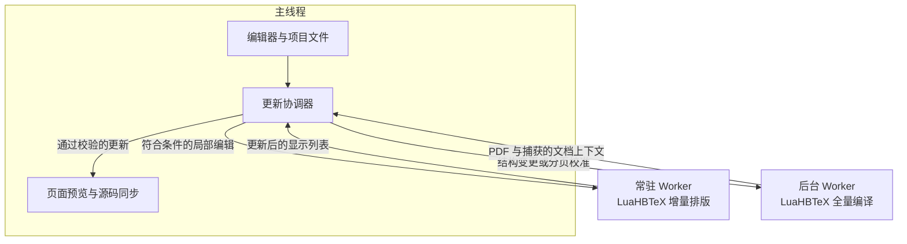

# ⚡ LightningTeX

**浏览器内的真 LuaHBLaTeX 增量排版引擎与现代写作工作区 —— 毫秒级局部实时预览，零后端依赖。**

[**在线体验 LightningTeX →**](https://lightningtex.vercel.app)

[**English**](README.md) · [**简体中文**](README.zh-CN.md) · [**独立引擎 SDK**](engine/README.md) · [**渲染器文档**](render/README.md) · [**源码构建说明**](engine/build/README.md) · [**自托管部署**](docs/DEPLOYMENT.md) · [**验收与基准数据**](QA.md)

<p align="center">
  
</p>

---

## 为什么构建 LightningTeX？

长期以来，LaTeX 写作者在工具选择上不得不面对一种两难妥协：

1. **云端或传统全量编译编辑器**：运行真实的 TeX 引擎，拥有精准的断行算法、宏展开与 PDF 输出；但每次修改都必须等待数秒的全文档重编译与服务器往返，打断写作心流。
2. **基于 HTML / MathJax / KaTeX 的快预览工具**：虽然能做到毫秒级响应，但它们只是 **TeX 的近似模拟**——依赖浏览器 DOM 排版而非 Knuth–Plass 段落断行，使用替代字体，无法执行真实的 LaTeX 计数器、前言自定义宏与宏包钩子，预览与最终 PDF 总是存在偏差。

**LightningTeX 打破了这一取舍。** 它将 [`realtime-tex`](https://github.com/HenryXiaoYang/realtime-tex) 的 Lua 端增量排版机制完整搬进浏览器：从 TeX Live 2026 源码裁剪构建 **LuaHBTeX 1.24.0 WebAssembly**，保留原生的文档捕获器、上下文回放、常驻段落服务与二进制显示列表（`RTDL`），并配以一套零框架依赖的现代 LaTeX 写作工作区。

### 核心产品理念

- **真 TeX 排版，绝不近似模拟**：正文段落、行内与独立公式（`equation`、`align`、`gather`、`multline`）、列表、章节标题、证明与定理环境（`theorem`/`lemma`/`proposition`/`corollary`/`remark`）全部由 **真实的 LuaHBLaTeX** 排版。所有字形均按整数 **scaled-point（`sp`，$1\text{ pt} = 65536\text{ sp}$）** 精确定位，并直接使用引擎原始字体轮廓（OpenType/TrueType 字形索引与 Type 1 PFB 原始轮廓）在 Canvas 上绘制，不使用另一套公式排版器或系统替代字体。
- **双轨协同管线（毫秒级局部重排 + 后台静默收敛）**：
  - **快路径（`Live` / `Reflow`，预热后约 5–20 ms）**：独立 Web Worker 中的常驻 LuaHBTeX 实例保持在 TeX 主循环（`\loop\rtexstep...\repeat`）内待命，回放目标单元的精确排版上下文，在 `\vbox` 中仅重排受影响的单元。几何不变时直接原位重绘墨迹区域；行数或公式高度变化、段落拆分/合并/删除时，动态切片并纵向平移下方 PDF 底图（标记为 `分页待校准`），实现打字不中断的即时视觉反馈。
  - **慢路径（`Full`）**：临时 `Reflow` 后停顿约 500 ms，后台 LuaHBTeX Worker 执行全量编译，更新分页、页码、目录书签与参考文献；前言、交叉引用或不支持的结构变更则直接路由至 `Full`。几何不变的 `Live` 更新保持预览即时刷新，不安排停顿全量编译；导出 PDF 时按需编译最新源码。
- **严密基线核验、保守回退与透明可观测**：在对任何单元执行首次增量更新前，系统都会先将捕获到的**原文**送入常驻引擎编译，逐行核对盒模型尺寸、粘连（glue）、字体签名、字形索引与相对坐标（`compareUnitBaseline`）。括号或公式定界符未闭合时静默保留上一帧有效预览，不会触发报错闪烁；光标处公式浮窗则自动补全未闭合分组进行实时预览。顶栏 **实时状态胶囊与检查器（Live Inspector）** 实时可视化最近 24 次更新的耗时柱状图、路由原因、常驻引擎健康度与 PDF 同步状态。
- **100% 纯前端运行，零后端与绝对隐私**：从 TeX 编译、JavaScript BibTeX `.bst` 样式解释、字体轮廓解析到多项目版本快照，全部在本地浏览器内完成。文档内容绝不上传任何服务器；导出 PDF 时始终确保生成包含最新修改的完整 PDF。

<table>
<tr>
<td width="33%" valign="top"><br><sub><b>整数 scaled point。</b>每个字形都按整数 <code>sp</code> 坐标、用自身的贝塞尔轮廓绘制。</sub></td>
<td width="33%" valign="top"><br><sub><b>条带重排。</b>公式变高时只展开它所在的条带并下移其后的页面，精确分页在后台静默收敛。</sub></td>
<td width="33%" valign="top"><br><sub><b>绝不显示残缺画面。</b>未闭合的 <code>\(</code> 让页面保持不动，光标浮窗实时排版补全后的公式。</sub></td>
</tr>
</table>

<sub>以上动图全部根据真实录制的引擎输出（显示列表、字形轮廓与实测耗时）逐帧渲染，没有任何手工模拟画面。</sub>

---

## 快速开始

### 1. 直接运行发布包

如果下载了预构建的「运行包」，其中已包含编译好的网页、WASM 引擎、TeX 基础宏包与字体，**无需 `npm install`，也无需在本地安装 TeX Live**。在 **Node.js 22.12+** 环境下运行：

```sh
node server.mjs
```

随后在桌面浏览器打开 **http://127.0.0.1:4173**（可通过 `PORT=8080 node server.mjs` 自定义端口）。

> [!IMPORTANT]
> **请勿直接双击打开 `index.html`**。Web Worker、流式 WASM 解压与 `SharedArrayBuffer` 增量通道需要 HTTP 安全上下文（`http://127.0.0.1` 或 `https://`）以及跨源隔离响应头（`COOP: same-origin`、`COEP: require-corp`）。附带的 `server.mjs` 默认仅监听本机并自动设置上述响应头。远程自托管或反向代理配置详见 [docs/DEPLOYMENT.md](docs/DEPLOYMENT.md)。

### 2. 从源码运行与构建

构建与测试要求 **Node.js 22.22.2+（22.x）、24.15.0+（24.x）或 26+**；上面的零依赖预构建服务器仍保留原运行要求。

```sh
npm ci
npm run dev       # 启动 Vite 开发服务器
npm run build     # 构建生产版本至 dist/
npm run preview   # 使用本机静态服务器运行 dist/ (http://127.0.0.1:4173)
```

部署到 Vercel：安装其 CLI，执行 `vercel login`，再在仓库根目录运行 `vercel --prod`。项目已包含首页路由和跨源隔离响应头配置，详见 [Vercel 部署步骤](docs/DEPLOYMENT.md#deploy-to-vercel)。

首次访问将分阶段流式加载约 **42.4 MiB** 的压缩引擎与数据（gzip 解压后约 54.4 MiB，内部 TeX 文件按 16 KiB LZ4 分块存储），加载过程中即可开始编辑。仅预装裁剪后的 TeX Live basic；当文档实际使用 `microtype`、`booktabs`、`enumitem` 等额外宏包时，引擎会自动按需下载并持久化至浏览器 `Cache Storage`。

---

## 核心技术架构

LightningTeX 将写作工作区与两个浏览器内的 LuaHBTeX Worker 分离：一个负责即时响应局部编辑，另一个负责生成完整 PDF 与文档布局。



### 双路径编译

常驻 Worker 在连续编辑间保留 TeX 运行时、前言与字体，通过共享内存请求通道，在 TeX 同步处理循环中接收新任务。后台 Worker 负责全文编译，包括交叉引用与参考文献处理。两个 Worker 复用已编译的 WebAssembly 模块，但各自保持独立的内存与文件系统。

### 捕获、回放与核验

全量编译捕获受支持文档单元的布局与排版上下文。局部编辑时回放这些上下文，保留计数器、字体与段落几何信息。某个单元首次接受增量编辑前，系统会先重排其原始源码，并与全量编译基线核对。不支持的编辑或未通过核验的更新回退至全量编译；多文件更新仅在整批有效且版本仍为最新时一并提交。

### 基于 TeX 输出的预览

渲染器按 TeX 给出的坐标绘制字形轮廓，将局部更新与 PDF.js 页面渲染合成，而不依赖浏览器文字排版。几何尺寸不变时只重绘受影响区域（`Live`）；高度变化时伸缩页面条带并移动下方内容（`Reflow`），待输入停顿后由后台编译恢复精确分页。输入尚未完整时保留上一帧有效预览。

### 编译与资源复用

裁剪后的 WebAssembly 构建与按需加载的 TeX 宏包减少初始运行时负担。浏览器缓存减少资源重复下载，辅助文件复用避免不必要的编译轮次。JavaScript BibTeX 解释器在浏览器内处理参考文献样式，使文档编译全程在客户端完成。

实现细节见[引擎 SDK](engine/README.md)、[渲染器文档](render/README.md)与[源码构建说明](engine/build/README.md)；性能实测见[验收与基准数据](QA.md)。

---

## 现代 LaTeX 写作工作区

LightningTeX 的工作区界面（[`ui/`](ui/editor.js)）采用原生 ES 模块从零构建，无任何前端框架依赖，围绕学术写作的高频交互打磨了完整的工具链：

| 模块 | 核心特性 |
| :--- | :--- |
| **实时状态胶囊与检查器 (Live Inspector)** | 顶栏状态胶囊实时显示最近一次局部更新耗时（如 `Live 6.1 ms`）与 12 帧迷你波形。点击展开 **Live Inspector**：展示最近 24 次更新的分类柱状时间线（`Live` / `Reflow` / `Full` / `Waiting`）、最新一次更新走该路径的具体原因、常驻引擎状态与重启计数、中位耗时，以及 PDF 同步状态（已同步、落后多少次编辑或正在更新）。 |
| **源码 ⇄ 预览双向字形级同步** | **源码 → 预览**：光标移动时在纸面侧边高亮对应段落/公式/标题位置；滚动离开视野时显示边缘定位胶囊。<br>**预览 → 源码**：单击渲染行时，`alignGlyph` 将经 NFKC 归一化的字形码点、连字与数学斜体匹配到源码，跳转至匹配单词；无法匹配时定位到近似行位置。 |
| **光标公式预览与智能悬停卡片** | **光标处公式浮窗**：复用常驻引擎与文档前言宏实时排版光标所在公式，未写完的括号、`{}`、`\left...\right.` 或环境会自动闭合预览，行内公式包裹于自然宽度 `\hbox` 中。<br>**悬停卡片（400 ms）**：悬停在 `\ref`/`\eqref` 上直接渲染目标公式预览；悬停在 `\includegraphics` 上显示图片缩略图与尺寸；悬停在自定义宏或 `\cite` 上展示宏定义或文献的标题、作者、年份与其他元数据。按住 `⌘/Ctrl` 点击或按 `F12` 直接跳转定义。 |
| **跨文件重构与灯泡快速修复** | **跨文件重命名（`F2`）**：在任意 `\label` 或引用处按 `F2`，实时预览所有受影响的文件与行，回车一次性完成跨文件替换并支持一键全局撤销；`⇧F12` 在引用面板列出所有引用位置。<br>**快速修复（`⌘.` / `Ctrl+.` 或行号 💡）**：针对未定义命令/环境推荐所属宏包（覆盖 80+ 常用宏包与拼写相近命令）或补全 `\newtheorem`；`Missing $ inserted` 自动用 `$…$` 包裹数学片段；未定义标签、文献键和文件路径列出编辑距离最近的候选；括号不匹配直接定位未闭合处。 |
| **补全、代码片段与可视化构建器** | 命令、环境、标签、文件路径与 `.bib` 文献（按键名、作者、年份、标题匹配）智能补全。支持 `fig`、`tab`、`mat`、`eq`、`beg` 行首 Tab 展开与镜像占位符跳转。内置 **表格与矩阵可视化网格选择器**（最大 10×8，支持 `booktabs` 三线表、列对齐、6 种矩阵括号、Tab 逐格填写，并自动将缺失的 `booktabs`/`amsmath` 加入前言）。 |
| **PDF 文本层、跨页视图与缩放** | 完整编译页面叠加 **PDF.js 文本层**：按住拖动即可选择复制 PDF 文字，预览聚焦时按 `⌘F` / `Ctrl+F` 在 PDF 全文中搜索高亮（如 `第 4 页 · 2 / 7`），单击仍保持跳回源码。支持触控板捏合与指针锚点缩放、单页 / 双页 / 双页（封面单独）视图、页面缩略图栏（`⌥⌘T`）与保色 **深色页面**。 |
| **多项目工作台与本地历史 Diff** | **IndexedDB v3 多项目隔离存储**（`⌘O` / `Ctrl+O`）：项目卡片展示首页缩略图、标题、修改时间与页数；支持模板画廊、ZIP 导入导出、多标签页独立打开不同项目；拖入或粘贴图片（GIF/WebP/BMP 自动转 PNG）自动存入 `figures/` 并插入引用。<br>**本地历史**：每次完整编译成功后（间隔满 5 分钟）自动保存文本文件快照（每项目最多 30 份），内置基于 Myers 算法的逐行 Diff 视图。可还原全部项目文本或单个文件，保留当前图片及其他二进制资源。 |

### 常用快捷键一览

| 快捷键（macOS / Win & Linux） | 功能说明 |
| :--- | :--- |
| `⌘Enter` / `Ctrl+Enter` | 立即执行完整 LuaHBLaTeX 编译 |
| `⌘K` / `Ctrl+K` | 打开命令面板（`@` 搜章节与标签，`>` 搜命令，`:行号` 跳转，内置数学符号搜索） |
| `⌘.` / `Ctrl+.` | 打开当前诊断行的「快速修复」菜单 |
| `F2` / `F12` / `⇧F12` | 跨文件重命名标签与引用 / 跳转到定义 / 查找所有引用 |
| `⌘F` / `Ctrl+F`；`⌘⇧H` / `Ctrl+Shift+H` | 源码查找与正则替换（当预览区聚焦时查找快捷键搜索 PDF 文字） |
| `⌘\` / `Ctrl+\` | 切换工作区布局（`源码` / `分栏` / `预览`） |
| `⌘B` / `⌘J` / `⌥⌘T` | 切换左侧栏（文件/大纲/标签） / 问题与日志面板 / PDF 页面缩略图栏 |
| `⌘O` / `⌘,` | 打开多项目管理页 / 打开可搜索的设置对话框 |
| `⌥↑` `⌥↓` / `⇧⌥↓` / `⌘⇧K` | 上下移动当前行 / 向下复制行 / 删除整行 |
| `⌘L` / `⌘D` | 选中整行（重复按向下扩展） / 选中当前词并跳至下一处相同文本 |

---

## 独立 WASM 引擎模块 (`@lightningtex/engine`)

LightningTeX 的底层排版引擎与前端 UI 完全解耦。运行 `npm run build:engine` 即可生成可独立部署的 `dist-engine/` 目录（或通过 `npm pack ./dist-engine` 打包分发），零运行时 npm 依赖，无需编辑器、PDF.js 或任何前端框架：

```js
import {
  createEngine, splitPreamble, captureSpans, unitContext,
  liveUnitEligibility, compareUnitBaseline, decodeDisplayList,
} from './dist-engine/index.js';

const engine = await createEngine({
  onLog: console.log,
  onFonts: fonts => { /* 每个常驻 Worker 生命周期内每个字体文件仅传输一次 */ },
});

// 1. 完整编译：返回 PDF、捕获元数据、各页显示列表、字体、aux 与缺失包记录
const full = await engine.background.compile(source, { root: 'main.tex', files: [] });

// 2. 启动常驻增量服务（直接复用已编译的 WebAssembly.Module）
await engine.live.start(
  splitPreamble(source).preamble + '\n\\RequirePackage{luatexbase}\n',
  full.aux, [], full.packageMisses,
);

// 3. 首次编辑某个捕获单元时核验原文基线，随后执行毫秒级增量排版
const span = captureSpans(source, full.capture).find(s => liveUnitEligibility(full.capture, s.unit).ok);
const ctx = unitContext(full.capture, span.unit);
const baseline = decodeDisplayList((await engine.live.compile(ctx, span.original, span.unit.advanced)).binary);
if (!compareUnitBaseline(span.unit, full.pages, baseline).ok) throw new Error('基线核验未通过');

const liveResult = await engine.live.typeset(ctx, '修改后的段落与公式 $\\sum_{i=1}^n x_i$。');
const displayList = decodeDisplayList(liveResult.binary);
```

完整的模块接口、多文件协作约定与选项说明见 [**engine/README.md**](engine/README.md)；独立 Canvas 显示列表渲染器文档见 [**render/README.md**](render/README.md)。

---

## 验证与性能基准

本项目包含 **218 项单元 / DOM / 渲染器测试** 以及多项基于真实 WebAssembly 与浏览器环境的端到端回归基准（在 Node `worker_threads` 及桌面 Chromium 中直接运行真实的 LuaHBTeX WASM、原项目 Lua 脚本与 Worker 代码）：

| 验证套件 / 基准测试 | 运行命令 | 核心实测结果 |
| :--- | :--- | :--- |
| **源码裁剪版引擎基准** | `node tests/engine-benchmark.mjs /tmp/engine-benchmark.json` | 新旧引擎三轮对照的字形、规则和坐标签名 **100% 一致**；本机冷加载中位数从 `689 ms` 降至 **`342 ms`**，增量服务启动从 `993 ms` 降至 **`675 ms`**；预热后核心请求仅 **`0.23–0.27 ms`**（浏览器预热 Live 实测 `4.7 ms`）。 |
| **26 次连续数学与正文增量回归** | `npm run test:incremental` | 涵盖行内公式、分式求和、编号 `equation`、`align`、`proof`/`abstract`、T1 字体与初始 PDF 中不存在的数学字形：**仅 1 次初始全量编译、0 次常驻引擎重启**，最终所有字形与 `sp` 坐标逐项等于独立重新完整编译的结果。 |
| **18 类局部重排与定理环境验证** | `npm run test:reflow` | 覆盖段落拆分/合并/删除、列表增项、公式增高、标题与共享编号的 `theorem`/`lemma`/`proposition`/`corollary`/`remark` 及定理内嵌套列表，字形、字号、进宽与标尺全部与独立全量编译一致。 |
| **112 步连续累积编辑与容错基准** | `npm run test:sequence` | 112 次有效局部修改 + 17 次未闭合公式输入（含跨页增删、首段前插入、整块删除与恢复），**仅 1 次初始全量编译、0 次引擎重启**，15 个检查点与独立全量编译逐项吻合（Node 编译+绘制中位耗时 **`5.95 ms`**）。 |
| **13 页真实学术论文逐键输入实测** | `tests/browser-input.html` | 含两张原始 PDF 插图的 13 页完整论文（46.5 KB 源码）：定理环境连续输入 20 键产生 11 次 Live 更新（**`9.9–17 ms`**），跨第 5–6 页证明连续输入 61 键产生 32 次 Live 更新（**`16–39 ms`**），打字期间全量编译次数为 0，停顿约 0.5 秒后自动完成全局校准。 |
| **多文件工程实时协同回归** | `npm run test:live-project` | 在 Node 中执行真实 `main.js` + WASM + Canvas 路径，验证 `\input` 末段、嵌套子文件、自带报告模板的正文与行间公式、嵌套导言依赖、多文件同批修改、过期响应丢弃与批次失败原子回退。 |
| **辅助文件复用与首遍捕获优化** | `npm run test:preview` | 辅助文件未变时单遍收敛使含目录/书签/子文件的全量编译中位耗时从 **`1.25–1.43 s` 降至 `0.62–0.71 s`**；冷启动首遍省略冗余页面捕获额外节省 **`110–210 ms`**，且归一化 PDF 字节完全一致。 |

### 编译路由与运行模型

- **增量与全量自动路由**：在已捕获的正文段落、数学环境、定理族、列表、引文与章节标题内的编辑由常驻 `LiveEngine` 处理（几何尺寸不变时走 `Live` 原位重绘；行数或高度变化时走 `Reflow` 条带伸缩）。修改前言、宏定义、文档结构、复杂绘图（如原始 PDF literal / TikZ）或跨文件耦合段落时，自动路由至后台 `Full` 全量编译。
- **停顿分页收敛与导出**：临时 `Reflow` 后停顿约 500 ms 会触发后台全量编译；几何不变的 `Live` 更新不安排这次编译。导出时若 PDF 落后于当前源码，会先编译最新源码。每次最多执行两遍，参考文献更新时最多三遍；若日志仍提示重跑，再次编译即可继续更新交叉引用。
- **参考文献管线**：后台 Worker 内置 JavaScript BibTeX 引擎，支持标准 `.bst` 样式（含 `biblatex` 的 `backend=bibtex`）；首次生成或更新 `.bbl` 时最多运行三遍，后续引用未变时直接复用 `.bbl`。
- **客户端沙箱与按需包加载**：全部编译在浏览器 WebAssembly 虚拟文件系统中执行，默认启用 `--no-shell-escape` 与 `--nosocket`。当文档引用未预装的 TeX Live 宏包或字体时，运行时仅按文件名向 `https://texlive2026.texlyre.org` 请求对应资源，全量任务将其下载的文件持久化至浏览器 `Cache Storage`（可通过 `endpoint: ''` 关闭远程查找或配置自建镜像）。

完整的基准测试数据与回归记录见 [**QA.md**](QA.md) 与 [`qa/`](qa/) 目录。

---

## 仓库目录结构

```text
LightningTeX/
├── main.js                  # 应用主协调器：PDF.js 渲染、局部擦除与条带重排、字形级双向同步
├── server.mjs               # 零依赖本地静态服务器（自动附加 COOP/COEP 跨源隔离头）
├── core/                    # 核心领域逻辑：源码准入策略、区间映射、上下文回放、局部布局、Myers Diff、快速修复
├── engine/                  # 独立 @lightningtex/engine 模块入口、Worker 客户端、内嵌 Lua/TeX (/rtex) 与源码构建脚本
├── render/                  # RTDL 二进制显示列表解码器、OpenType/Type 1 PFB Canvas 渲染器、保色深色页面滤镜
├── ui/                      # 零依赖工作区界面：代码编辑器、实时检查器、悬停卡片、补全、IndexedDB v3 多项目存储
├── public/
│   ├── luahbtex/            # 源码裁剪构建的 LuaHBTeX 1.24.0 WASM 与 TeX Live 2026 LZ4/gzip 分块资源
│   └── runtime/             # Web Worker 运行时（background-worker、live-worker、raw-loader、tex-packages、JS bibtex）
├── scripts/                 # 资源哈希校验、16 MiB 分块打包器与独立引擎构建脚本
├── tests/                   # 218 项单元/DOM 测试 + 真实 WASM 增量、重排、连续输入、参考文献与性能基准套件
└── docs/                    # 自托管部署指南、架构移植审计与运行时探针文档
```

### 常用开发与验证命令

```sh
npm test                     # 运行全部 218 项单元、DOM 与显示列表渲染器测试
npm run test:runtime         # 真实 WASM 冒烟测试（全文编译、捕获、错误恢复）
npm run test:integration     # 端到端 WASM 集成测试
npm run test:preview         # 验证辅助文件单遍复用、冷启动首遍优化与目录/书签输出
npm run test:incremental     # 26 次连续数学/正文增量编辑与最终字形坐标一致性回归
npm run test:reflow          # 18 类真实 WASM 局部重排与定理环境回归测试
npm run test:sequence        # 112 步累积连续输入与未完成公式容错基准测试
npm run test:project         # 多文件项目与光标处公式预览 WASM 回归测试
npm run test:live-project    # 真实 main.js + WASM + Canvas 多文件批次更新测试
npm run test:bibliography    # 浏览器内置 JS BibTeX (.bst) 与多遍文献编译回归测试
npm run test:engine          # 构建并拷贝至仓库外验证 @lightningtex/engine 独立分发包
```

---

## 来源致谢与开源许可

LightningTeX 的构建基于以下优秀的开源项目：

- **[realtime-tex](https://github.com/HenryXiaoYang/realtime-tex)**（MIT，固定提交 `1f681835cfcbeeabcca340b7784316a0ef186d81`）—— 提供 Lua 端增量捕获、上下文回放、常驻段落服务与二进制显示列表协议。
- **[TeXlyre BusyTeX](https://github.com/TeXlyre/texlyre-busytex/releases/tag/assets-v1.4.0) 与 [texlyre-busytex-build](https://github.com/TeXlyre/texlyre-busytex-build)**（`f544a51a`，内含 TeX Live 2026、LuaHBTeX 1.24.0）—— 提供 Web2C Emscripten 构建规则与基准 TeX Live 2026 数据快照。
- **[PDF.js](https://github.com/mozilla/pdf.js)**（`6.4.299`，Apache-2.0）—— 用于完整 PDF 页面栅格化、文本层交互以及 Type 1 PFB 字形轮廓转换。
- **[OpenType.js](https://github.com/opentypejs/opentype.js)**（`2.0.0`，MIT）—— 用于显示列表 Canvas 渲染器的字形轮廓解析。
- **[Inter](https://github.com/rsms/inter)**（`5.2.5`，SIL OFL 1.1）—— 随应用本地打包的拉丁可变界面字体。

本项目按 **GNU Affero General Public License v3.0 or later ([AGPL-3.0-or-later](LICENSE))** 许可证分发；随附的 TeX 引擎、宏包与字体保留各自原始许可证，完整来源、固定版本与哈希记录见 [**THIRD-PARTY-NOTICES.md**](THIRD-PARTY-NOTICES.md)。用户使用本应用生成的 PDF 文档与源码不会因使用本应用而受到 AGPL 约束。

两种构建产物均附带许可证副本和对应的 `source.zip`。源码获取、上游输入与重建步骤见 [**SOURCES.md**](SOURCES.md)。
